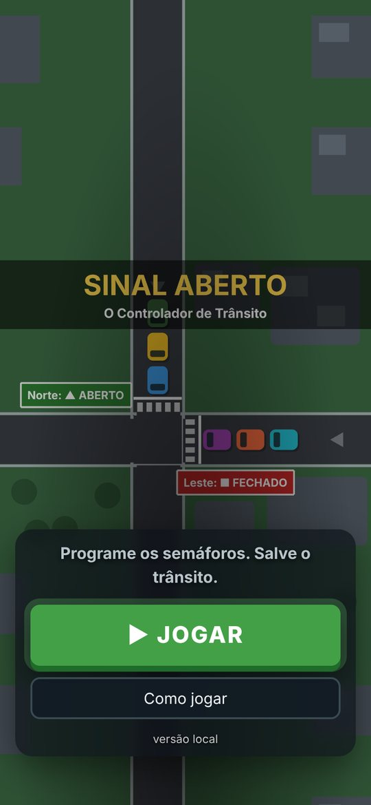
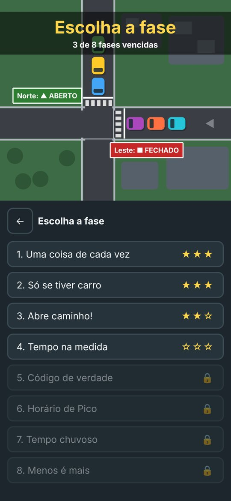
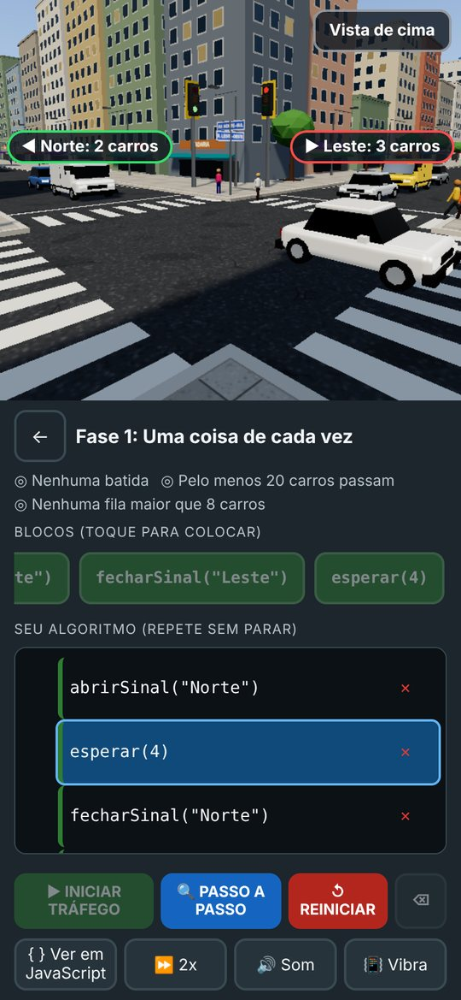
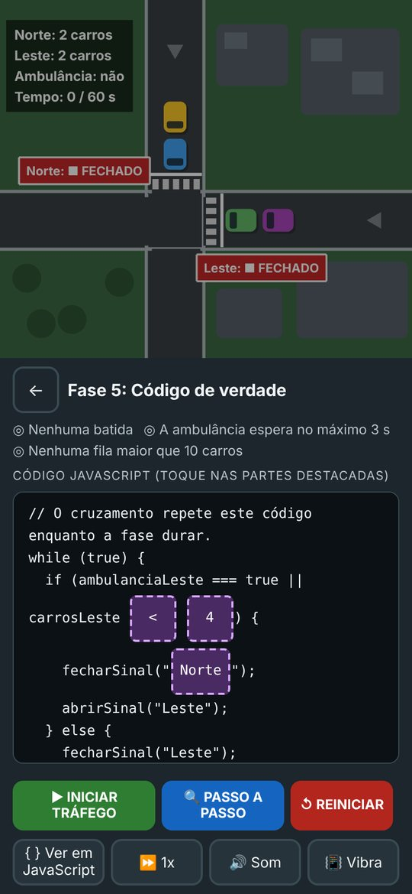
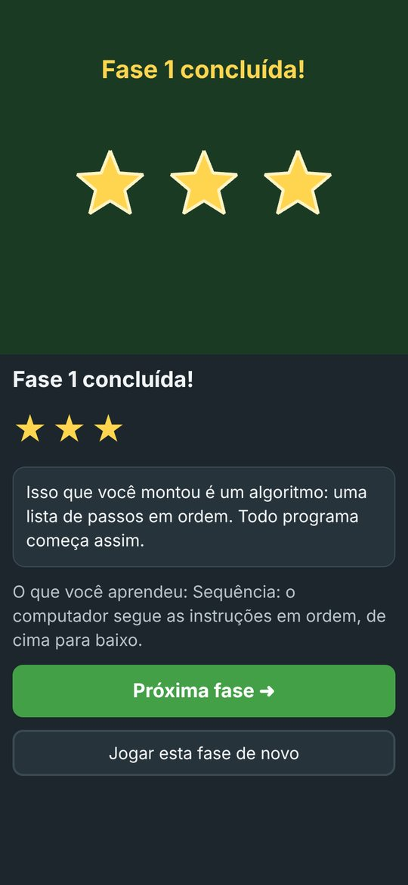
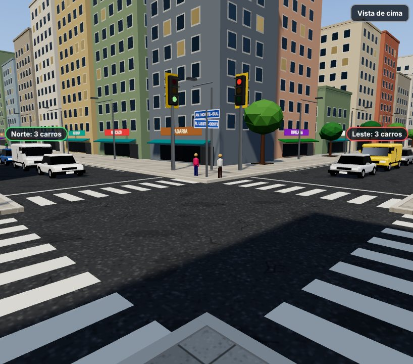
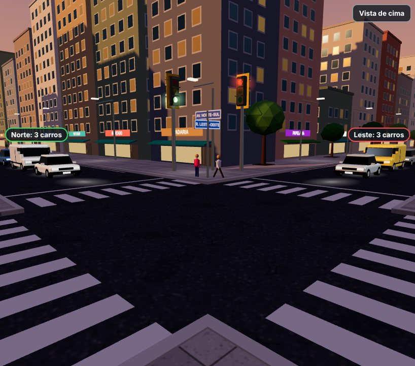
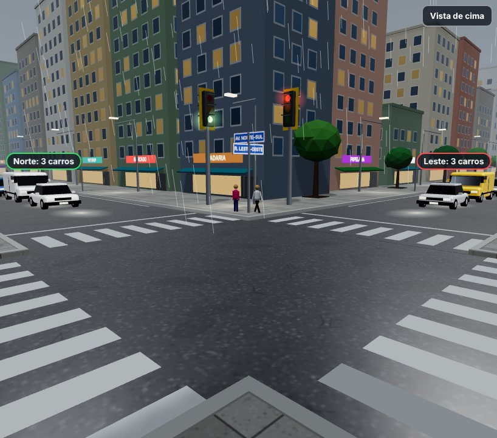
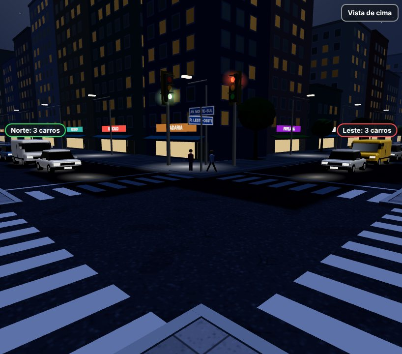

# GDD - Sinal Aberto: O Controlador de Trânsito

**Versão:** 0.4.0
**Data:** 2026-10-12
**Repositório:** https://github.com/Joaopedro0s/sinal-aberto

## Premissa e problema

Muitos jovens que querem entrar na área de tecnologia estudam em escola pública, moram na periferia e têm como único computador um celular de entrada, com internet móvel limitada e instável. Os cursos e jogos de programação, em geral, pedem computador, conta, instalação ou conexão boa, e usam termos técnicos que afastam quem está começando do zero.

O Sinal Aberto é um protótipo gamificado que ensina a base da lógica de programação (sequência, condição, operadores lógicos, variáveis, depuração e leitura de código real) usando algo que todo jovem conhece da rua: o semáforo. Sinal verde e vermelho viram "verdadeiro" e "falso" de forma natural, sem jargão.

## High concept

Você é o guarda que programa os semáforos de um cruzamento, em pé na esquina, vendo a cidade em 3D e em primeira pessoa. Em vez de apertar botões na hora certa, você monta, tocando em blocos, as regras que o semáforo vai seguir sozinho e solta o trânsito. Se a lógica estiver certa, os carros fluem; se os dois sinais abrirem juntos, os carros batem, o jogo congela e mostra a linha do erro. A cada fase surge um conceito novo: sequência, "se", "se/senão" com "OU" para dar passagem à ambulância, variáveis para ajustar o tempo de verde à fila, um código JavaScript de verdade com um erro para o jogador encontrar e consertar e, nas últimas fases, horário de pico, chuva e otimização (fazer mais com menos blocos). Quanto mais difícil a fase, mais tarde fica na cidade: dia, fim de tarde, chuva e noite. Roda no navegador do celular, sem login, sem instalação e até offline.

## Gênero e plataforma

- **Gênero:** quebra-cabeça de programação / automação, educativo.
- **Plataforma:** web estática (HTML5), feita para celular na vertical (9:16). No celular deitado e no computador, o cruzamento ocupa a tela toda e a Mesa de Programação fica ao lado.
- **Tecnologia:** Phaser 3 (telas 2D) + Three.js (cruzamento em 3D) + TypeScript + Vite. O build é um único `index.html` (com tudo embutido) publicado no GitHub Pages e também entregue em `build.zip` para jogar offline.
- **Offline (PWA):** no site, um Service Worker guarda a versão aberta para jogar sem internet depois do primeiro acesso. Ele cuida só da pasta da própria release, busca a rede primeiro e nunca guarda o carregador da raiz nem o `rollout.json` (o canário e o rollback continuam funcionando).
- **Sem servidor:** não há banco de dados, login nem coleta de dados. O progresso (estrelas por fase) fica só no `localStorage` do navegador.

## Mecânicas-core

1. **Montar o algoritmo tocando:** a gaveta de blocos mostra só os blocos da fase. Tocar em um bloco coloca uma nova linha no fim do algoritmo (sem arrastar). O botão de apagar remove a última linha.
2. **Ciclo contínuo:** o algoritmo é o "controlador" do cruzamento e repete sem parar enquanto a fase dura (40 a 60 segundos simulados). Abrir e fechar sinal são instantâneos; `esperar(n)` faz o tempo andar. Ao chegar ao fim, volta para a linha 1.
3. **Simulação determinística:** os carros chegam em fila com taxa definida por fase e números aleatórios com semente fixa, então a mesma solução sempre dá o mesmo resultado. O motorista leva 1 s para arrancar e 0,6 s para atravessar, por isso fechar um sinal e abrir o outro em seguida é seguro.
4. **Batida:** acontece quando há carros das duas vias dentro do cruzamento ao mesmo tempo (ou seja, os dois sinais ficaram verdes). O jogo congela, toca um som de freio, a linha responsável fica vermelha e aparece uma orientação simples, por exemplo: "Os dois sinais ficaram abertos na linha 3. Feche o Norte antes de abrir o Leste."
5. **Proteção contra repetição sem fim:** se o algoritmo repetir muitas vezes sem nenhum `esperar`, o jogo para e explica que falta um bloco `esperar`.
6. **Passo a Passo:** cada toque executa uma linha, destaca essa linha e mostra o efeito no cruzamento. Também serve para pausar o trânsito no meio.
7. **Ver em JavaScript:** em todas as fases, um botão mostra o algoritmo do jogador convertido em JavaScript real. É a ponte entre o bloco e o texto.
8. **Objetivos e estrelas:** cada fase tem objetivos medidos pela simulação (sem batida, quantidade de carros que passam, maior fila, espera da ambulância, tempo de sinal verde sem carros). Estrelas: 3 se cumprir tudo com até o número ideal de linhas, 2 com até duas linhas a mais, 1 se só cumprir os objetivos.
9. **Sem eval:** o jogo nunca executa texto. Os blocos viram uma árvore de sintaxe (AST) que um interpretador próprio percorre. Mesmo na fase 5, tocar no código muda a AST, não o texto.
10. **Vista 3D em primeira pessoa:** o jogador é o guarda de trânsito no posto da esquina e vê os carros chegarem, pararem na faixa e cruzarem na frente dele. Dá para olhar em volta arrastando o dedo (ou com as setas do teclado) e trocar para a **vista de cima**, que mostra o cruzamento inteiro para planejar. Um placar flutua sobre cada fila ("Norte: 3 carros"); se a fila sair da tela, o placar gruda na borda com uma seta apontando para ela.
11. **A simulação manda, o 3D só mostra:** a vista 3D lê o mesmo estado da simulação que a vista 2D. Pedestres, modelos de carro, luz amarela e hora do dia são só visuais e não mudam o resultado nem as estrelas.

## Enredo e personagens

A cidade vive engarrafada e o controlador automático do cruzamento central quebrou. Você é a nova pessoa responsável por programar os semáforos. Não há personagens com fala: os protagonistas são os motoristas (carros coloridos), a ambulância que precisa passar rápido e a própria cidade, que vai do caos ao trânsito fluindo. No fim, a cidade fica sem engarrafamento e o jogo revela que aquilo que você montou e consertou é código de verdade.

## Fluxo do jogo

```
+--------+     +------------------+     +-------------------------+
|  Menu  | --> | Seleção de fases | --> | Dica curta da fase      |
+--------+     |  (estrelas,      |     +-------------------------+
    ^          |   cadeado)       |                 |
    |          +------------------+                 v
    |                  ^             +-------------------------------+
    |                  |             | Mesa de Programação           |
    |                  |             | montar -> INICIAR / PASSO A   |
    |                  |             | PASSO -> simulação            |
    |                  |             +-------------------------------+
    |                  |                  |                  |
    |                  |          batida, erro ou      objetivos
    |                  |          objetivo faltando    cumpridos
    |                  |                  |                  |
    |                  |                  v                  v
    |                  |        +-------------------+  +----------------------+
    |                  |        | Linha destacada + |  | Fim de fase: estrelas|
    |                  |        | dica -> corrigir  |  | conceito e revelação |
    |                  |        +-------------------+  +----------------------+
    |                  |                                     |
    |                  +----------- próxima fase ------------+
    |                                                        |
    +------------------ fim de jogo (após a fase 8) ---------+
```

## Telas do jogo

Abaixo estão capturas de tela reais do Sinal Aberto (celular na vertical), na ordem em que o jogador as encontra.

### Menu principal



O cruzamento animado ocupa a tela inteira, com o título "SINAL ABERTO – O Controlador de Trânsito" no alto. Embaixo, um cartão com a chamada "Programe os semáforos. Salve o trânsito.", o botão grande **JOGAR**, o botão **Como jogar** (abre uma janela com instruções curtas) e a versão no rodapé.

### Seleção de fases



Lista com as 8 fases. Cada item mostra o número, o título e as estrelas conquistadas, ou um cadeado se a fase anterior ainda não foi vencida. O canvas mostra quantas fases já foram vencidas e o botão de voltar retorna ao menu.

### Cruzamento em 3D + Mesa de Programação



A tela de jogo principal, dividida em duas partes:

- **Cruzamento (parte de cima):** a cidade em 3D vista pelo guarda na esquina, com prédios, lojas, árvores, postes, faixas de pedestre, placas de rua, pedestres e carros de vários modelos. Os dois semáforos ficam na esquina da frente: o da esquerda é o do Norte e o da direita é o do Leste. O botão **Vista de cima** troca a câmera, e os placares mostram quantos carros há em cada fila.
- **Mesa de Programação (parte de baixo):** objetivos da fase, gaveta de blocos com rolagem horizontal (cores por categoria), lista numerada do algoritmo montado e barra de ação com **INICIAR TRÁFEGO**, **PASSO A PASSO**, **REINICIAR**, apagar, **{ } Ver em JavaScript**, velocidade (1×, 2×, 4×), som e vibração.

Em aparelhos sem placa de vídeo, ou lentos demais, a mesma tela aparece com o cruzamento em 2D visto de cima (como na fase 5, abaixo).

### Fase 5: editor de código JavaScript



Em vez da gaveta de blocos, a parte de baixo mostra o código JavaScript do controlador com partes destacadas, que funcionam como botões. Cada toque troca o valor pela próxima opção válida (por exemplo, `<` vira `>`, `2` vira `4`, `Norte` vira `Leste`). O jogador encontra e corrige o erro sem digitar. Esta captura mostra a vista 2D do cruzamento, com o painel de valores ao vivo e os sinais com ABERTO (triângulo) e FECHADO (quadrado).

### Fim de fase / fim de jogo



Depois de cumprir os objetivos, aparecem as estrelas conquistadas (de 1 a 3), uma "revelação" (o que o jogador acabou de fazer em termos de programação) e o conceito aprendido. Os botões levam à próxima fase ou repetem a atual. Na última fase, o jogo mostra o algoritmo final em JavaScript e volta ao menu.

### Ambientes da vista 3D









A hora do dia acompanha a dificuldade. No **fim de tarde** (o "horário de pico") o céu fica alaranjado, as sombras ficam compridas e os faróis acendem. Na **chuva** o céu fica cinza, cai chuva na tela e o asfalto molhado reflete as luzes; os carros também ficam mais lentos na simulação. À **noite** aparecem estrelas e lua, os postes iluminam o chão, as janelas e vitrines acendem e os semáforos brilham.

## Level design

| Fase | Conceito | Cenário | Objetivos | Solução de referência (linhas ideais) |
| --- | --- | --- | --- | --- |
| 1. Uma coisa de cada vez | Sequência | Horário de pico no Norte e no Leste | Sem batida; pelo menos 20 carros passam; nenhuma fila maior que 8 | abrir Norte, esperar 4, fechar Norte, abrir Leste, esperar 4, fechar Leste (6) |
| 2. Só se tiver carro | Condição (`if`) | Leste vazio; Norte com ondas de carros | Sem batida; pelo menos 10 carros passam; sinal verde sem carros por no máximo 5 s | se (carrosNorte > 0) { abrir Norte, esperar 3, fechar Norte }, esperar 1 (6) |
| 3. Abre caminho! | `if/else` e OU | Ambulâncias chegando pelo Leste | Sem batida; ambulância espera no máximo 2 s; nenhuma fila maior que 9 | se (ambulanciaLeste == verdadeiro OU carrosLeste > 5) { fechar Norte, abrir Leste } senão { fechar Leste, abrir Norte }, esperar 2 (8) |
| 4. Tempo na medida | Variáveis | Norte com rajadas fortes e períodos calmos | Sem batida; nenhuma fila maior que 8; sinal verde sem carros por no máximo 6 s | tempoVerde = carrosNorte * 1.5, abrir Norte, esperar(tempoVerde), fechar Norte, abrir Leste, esperar 3, fechar Leste (7) |
| 5. Código de verdade | Ler e consertar JavaScript | Controlador escrito em JS com um erro; fim de tarde | Sem batida; ambulância espera no máximo 3 s; nenhuma fila maior que 10 | trocar `carrosLeste < 4` por `carrosLeste > 4` |
| 6. Horário de Pico | Escalabilidade (variável que acompanha a fila) | Muitos carros nas duas vias; fim de tarde | Sem batida; nenhuma fila maior que 18; pelo menos 30 carros passam | tempoAberto = carrosNorte * 1.5, abrir Norte, esperar(tempoAberto), fechar Norte, abrir Leste, esperar 4, fechar Leste (7) |
| 7. Tempo chuvoso | Condições adversas | Chuva: carros 50% mais lentos para arrancar, atravessar e entrar um atrás do outro | Sem batida; nenhuma fila maior que 18; pelo menos 18 carros passam | tempoAberto = carrosNorte * 2.5, abrir Norte, esperar(tempoAberto), fechar Norte, abrir Leste, esperar 6, fechar Leste (7) |
| 8. Menos é mais | Otimização (comparar duas variáveis) | Norte mais cheio que o Leste; noite | Sem batida; nenhuma fila maior que 7; no máximo 9 blocos | se (carrosNorte > carrosLeste) { fechar Leste, abrir Norte } senão { fechar Norte, abrir Leste }, esperar 4 (8) |

Detalhes de design:

- **Fase 2** usa o tempo de sinal verde sem carros (pedestres esperando à toa) para que o `se` seja necessário: deixar o sinal sempre aberto ou abrir sem conferir perde.
- **Fase 3** exige o OU: só a ambulância deixa a fila do Leste crescer; só a fila grande faz a ambulância esperar demais. O operador E aparece na gaveta como distrator e também perde. Diferente do esboço original do GDD, a solução fecha um sinal antes de abrir o outro, senão haveria batida.
- **Fase 4** tem trânsito em rajadas para que nenhum tempo fixo funcione: tempo curto deixa a fila do Norte crescer; tempo longo deixa o sinal verde à toa e a fila do Leste crescer.
- **Fases 6 e 7** reaproveitam a ideia da fase 4 em situações mais difíceis: no pico o multiplicador da fase 4 ainda serve, mas na chuva os carros demoram mais e é preciso dar mais tempo de verde (×2,5).
- **Fase 8** limita o número de blocos: a força bruta (sequências longas) não cabe, e a solução é comparar as duas filas.
- **Fase 5** é interativa: o código aparece como JavaScript, e as partes destacadas (`<`/`>`/`===`, `2`/`4`/`6` e `Norte`/`Leste`) mudam a cada toque. O código continua sendo interpretado pela AST.
- Para cada fase, `src/content/fases.json` guarda a solução de referência e uma solução errada conhecida; os testes de integração garantem que a primeira vence e a segunda perde. Os números de cada fase foram calibrados rodando a simulação contra soluções certas e erradas.

## UI/UX e acessibilidade

- **Layout vertical:** cruzamento em cima (cerca de 40% da tela), em 3D com placares sobre as filas ou, na vista 2D, visto de cima com um painel de valores ao vivo (por exemplo "Norte: 4 carros", "Ambulância: SIM"). No celular deitado e no computador, o cruzamento ocupa a tela e a Mesa fica numa coluna ao lado. Embaixo (cerca de 60%), a Mesa de Programação em HTML: objetivos, gaveta com rolagem horizontal, linhas do algoritmo e barra de ação (INICIAR TRÁFEGO, PASSO A PASSO, REINICIAR, apagar), além de "Ver em JavaScript", velocidade (1x, 2x, 4x) e som.
- **Cores dos blocos (do GDD original):** amarelo para "se", laranja para "senão" e "fim", roxo para comparações e E/OU, azul para variáveis, verde para ações.
- **Semáforo não depende só de cor:** na vista 2D, o sinal aberto mostra um triângulo e a palavra ABERTO e o fechado mostra um quadrado e a palavra FECHADO. No 3D, o semáforo tem três luzes em posições fixas (vermelho em cima, amarelo no meio, verde embaixo), como na rua, e os placares mostram as filas em texto.
- **Toque:** todos os botões têm pelo menos 44 x 44 px; não há arrastar.
- **Contraste alto:** tema escuro, textos claros, linha ativa em azul e linha com erro em vermelho com contorno (não só cor).
- **Teclado e leitor de tela:** tudo é botão HTML de verdade (Tab e Enter funcionam); na vista 3D as setas olham em volta e a tecla V troca entre primeira pessoa e vista de cima; com rótulos `aria-label`, anúncios em `aria-live` quando uma linha é colocada ou apagada, janelas com Esc para fechar e foco devolvido; Backspace apaga a última linha.
- **Textos simples:** dicas curtas, sem jargão, e mensagens de erro que dizem o que fazer.
- **Telas pequenas e rede ruim:** um único arquivo, sem fontes nem imagens externas.
- **Celular fraco:** o jogo mede o FPS nos primeiros segundos. Se o aparelho não aguentar, liga um modo econômico (menos resolução, sem sombras nem nevoeiro); se ainda assim ficar travado, volta para a vista 2D. Sem placa de vídeo (desenho por software), já abre direto no 2D. A escolha vale para a sessão inteira, então o jogo não fica alternando entre 3D e 2D a cada fase.

## Áudio

Todos os sons são sintetizados na hora com a Web Audio API (nenhum arquivo de áudio): freio e baque na batida, arpejo na vitória, bipes graves em erro e um clique curto ao colocar blocos. Há um botão para ligar e desligar o som.

## Arte e referências

- **Telas 2D (menu, seleção de fases, fim de fase e vista 2D do cruzamento):** estilo flat, vista de cima, formas geométricas desenhadas em código (Phaser Graphics). Os carros são retângulos arredondados coloridos e a ambulância é branca com faixa vermelha e luz piscando.
- **Cruzamento em 3D:** estilo low-poly com luz realista (tons de cinema ACES, sombras suaves do sol e reflexos na lataria e nos vidros). Tudo é montado em código com Three.js, sem nenhum arquivo de modelo ou imagem:
  - **Cidade:** prédios com janelas, platibanda, caixas d'água e ar-condicionado; lojas no térreo com vitrine, toldo e letreiro (MERCADO, PADARIA, FARMÁCIA...); árvores, postes com braço sobre a pista, placa azul com o nome das ruas e placa de 40 km/h.
  - **Rua:** asfalto, calçada de lajotas e grama com texturas desenhadas em canvas; meio-fio, linhas de bordo, faixas zebradas e linhas de retenção.
  - **Semáforo brasileiro:** caixa preta com três luzes, "bonés" e placa de fundo amarela. Ao fechar, o amarelo acende por um instante antes do vermelho.
  - **Veículos:** sedã, hatch, SUV, furgão e moto com piloto, nas cores mais comuns da frota (muito branco, prata e preto). Lanternas acendem ao frear e, no escuro, os faróis iluminam o chão.
  - **Pedestres:** gente passeando nas calçadas e atravessando nas faixas quando o sinal daquela rua fecha (e apressando o passo se o sinal abrir no meio da travessia).
  - **Céu e clima:** dia, fim de tarde, chuva e noite, conforme a fase.
- Não há nenhum asset de terceiros, marca, logo ou personagem existente.
- **Referências (inspiração, sem copiar nada):** Lightbot e Human Resource Machine (quebra-cabeças de programação), Scratch e Blockly (programação por blocos), Mini Motorways (trânsito urbano como quebra-cabeça) e simuladores 3D de cidade e de loja, no visual limpo e colorido.

## Uso de IA e componentes de terceiros

- **IA:** o esqueleto inicial e a esteira foram feitos com o Gemini 3.1 Pro; a troca para o Sinal Aberto (núcleo, fases, cenas, testes e documentação) foi feita com o Claude Opus 5.5 no Claude Code; a vista 3D em primeira pessoa, o visual realista e a cidade viva foram feitos com o Claude Opus 5.5 no Claude (modo Cowork). Tudo foi revisado e testado pelo integrante responsável. Detalhes em `AI-USAGE.md`.
- **Componentes de terceiros:** Phaser 3 (MIT), Three.js (MIT) e Ajv (MIT) no jogo; Vite, TypeScript, Vitest, Playwright e ESLint no desenvolvimento. Lista completa e licenças em `THIRD_PARTY.md` e no SBOM gerado pela esteira.

## Próximos passos

- Testes de usabilidade com jovens do público-alvo e ajuste da dificuldade.
- Novas fases: repetição com contador, quatro vias (Sul e Oeste) e semáforo de pedestres programável (hoje os pedestres da vista 3D são só visuais).
- Manifesto de PWA (ícone e "adicionar à tela inicial"), aproveitando o Service Worker que já existe.
- Modo professor com relatório local (sem dados pessoais) e tradução para outras línguas.
- Tamanho: o GDD original citava menos de 1 MB, o que não é possível com o Phaser e o Three.js. O build atual tem cerca de 2,2 MB (cerca de 540 kB comprimido), bem abaixo do limite de 5 MB.

## Esteira

```
 push / PR
    |
    v
+-------------------------------------------------------------+
| CI: lint -> testes + cobertura (JUnit) -> Gitleaks ->       |
|     npm audit + SBOM -> build (+ sw.js) -> GDD.pdf ->       |
|     build.zip + SHA-256                                     |
+-------------------------------------------------------------+
    |  (só na main)
    v
+------------------------+     +------------------------------+
| Deploy HML (/hml/)     | --> | E2E Playwright em /hml/      |
+------------------------+     +------------------------------+
                                     |
                                     v
+------------------------------------+     +-------------------------+
| Deploy PRD canário                  | --> | Smoke E2E na release    |
| (/releases/<sha>/ + rollout 10%)    |     +-------------------------+
+------------------------------------+        |                |
                                          sucesso            falha
                                              |                |
                                              v                v
                                        promover 100%      rollback
```

Tags `v*.*.*` geram uma release no GitHub com `build.zip`, o hash SHA-256, o SBOM e o `GDD.pdf`.

Repositório: https://github.com/Joaopedro0s/sinal-aberto
